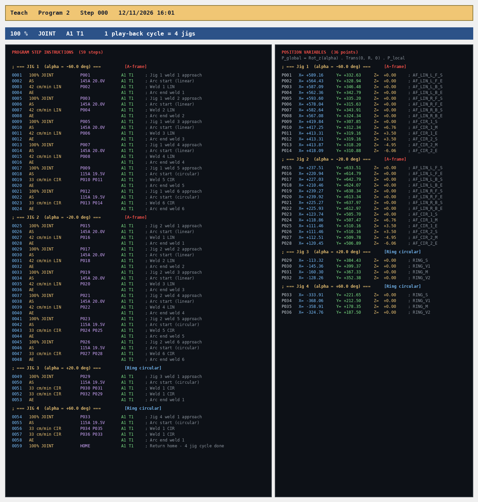

# weld-path-generator

A small Python tool that generates the TCP (tool center point) weld path for a
robotic welding cell with several jigs on a semicircular table.

The path of each part is defined once, in the local frame of its jig. The tool
then places it on every jig with a 4x4 homogeneous transform:

```
P_global = Rot_z(alpha) . Trans(0, R_table, 0) . P_local
```

> **All dimensions, angles and welding parameters in this repository are
> illustrative values. They are not production data.**

## What it does

1. Checks the weld heat input, `Q = eta * I * V / v`, against a design target
   with a tolerance. The run stops if a process is outside the tolerance.
2. Builds the local waypoints of three part types:
   - `aframe`: 4 linear fillets at the apex and 2 circular arcs on the crossbar joint (14 points)
   - `box`: 2 parallel linear welds (4 points)
   - `ring`: 1 full circular weld made of two half arcs (4 points)
3. Transforms the waypoints to the table frame for every jig in the preset.
4. Writes a teach-pendant style program listing (`.txt`) and a PNG preview.

Two layouts are included:

| Preset | Jigs | Global points | Steps |
|--------|------|---------------|-------|
| `5jig` | 2 A-frame, 1 box, 2 ring | 40 | 67 |
| `4jig` | 2 A-frame, 2 ring | 36 | 59 |

## Run

```bash
pip install -r requirements.txt
python weld_path_generator.py --preset 5jig --outdir examples
python weld_path_generator.py --preset 4jig --outdir examples
```

Options: `--no-png` skips the image. Pillow is only needed for the image.

Example output is in [`examples/`](examples/).



## Test

```bash
python -m pytest
```

The tests cover the heat input formula, the waypoint counts, the transform
(distances are kept, jig origins lie on the table radius), and the step list
(every step points to an existing position).

## Add a new part or layout

- New part: write a `part_xxx()` function that returns `(points, welds)` and
  register it in `PARTS`.
- New layout: add an entry to `PRESETS` with the jig angles and part types.

## Limits

- The listing is a readable, teach-pendant style format. It is not a file that
  a robot controller can import directly.
- Only the TCP position is generated. Torch orientation, approach and retract
  points, and collision checks are not included.
- Before any real use, every point must be verified on the robot at low speed.

## Background

This is a simplified, public version of work I did on a welding robot retrofit
for my final-year thesis (Electrical Engineering). Part geometry and welding
parameters were replaced with illustrative values.
